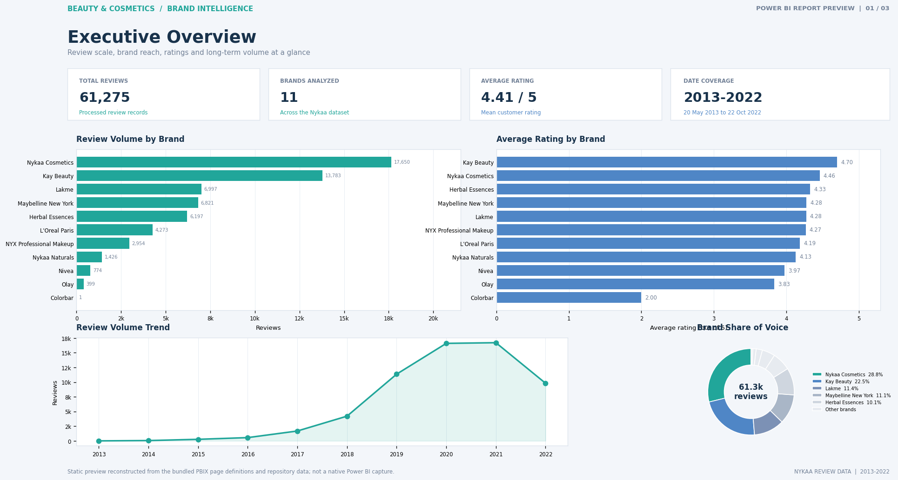
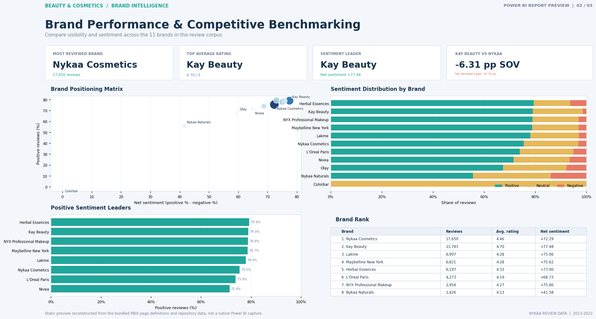
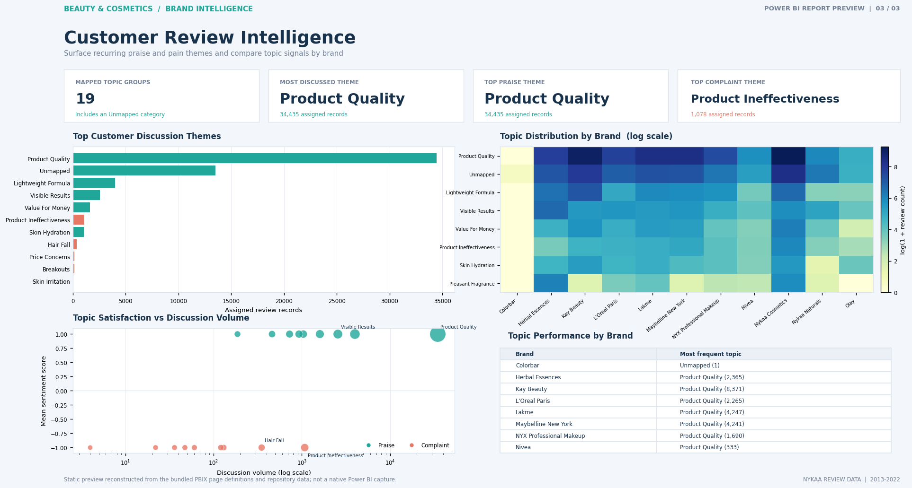

# Beauty & Cosmetics Brand Intelligence Platform

An end-to-end analytics project that turns beauty product reviews into brand, sentiment, and voice-of-customer insights. Python prepares and analyzes review data, exports a Power BI-ready star schema, and the included Power BI report presents the results across three report pages.

> **Scope:** The current analytics workflow is based on Nykaa cosmetics and beauty product reviews. It is not the Reddit-only prototype described in the previous README.

## Dashboard previews

The images below are **static previews**, reconstructed from the report page definitions in the PBIX and the project’s analytical exports. They are not direct screenshots captured from Power BI Desktop, and do not include Power BI interactions. Open [Brand_Competitor_Intelligence_Engine.pbix](./Brand_Competitor_Intelligence_Engine.pbix) in Power BI Desktop for the native interactive report.

### Executive overview



### Brand performance and competitive benchmarking



### Customer review intelligence



## What the project does

The workflow:

1. Reads and standardizes the Nykaa reviews CSV.
2. Validates review records and can store standardized data in SQLite.
3. Assigns review-level sentiment using a local cosmetics-focused lexicon.
4. Maps high-confidence praise and complaints to business-facing customer themes.
5. Calculates brand, competitor, customer-experience, and operational metrics.
6. Exports fact and dimension tables for Power BI.

### Current dataset profile

The supplied project reports describe a dataset of **61,284 source rows** from **11 brands**, covering **20 May 2013 through 22 October 2022**. The source has nine reviews without review text; the sentiment results contain **61,275 usable reviews**. The mean source rating is approximately **4.41 out of 5**.

The data is heavily weighted toward positive ratings and reviews. Sentiment labels and topic categories are automated analytical signals, not verified measures of customer intent or clinical product performance.

## Analytics and methodology

- **Sentiment:** `pipeline_sentiment.py` explicitly selects the local lexicon fallback (`force_fallback=True`). It combines review title and text, then records a positive, neutral, or negative label, a sentiment score, and a confidence value. Although a transformer path exists in the analyzer, it is not used by this pipeline run.
- **Voice of Customer (VoC):** `TopicExtractor` defaults to its lexical category fallback. Positive and negative reviews with confidence of at least `0.80` are assigned to cosmetics-oriented praise or complaint themes. Unmatched records remain `Unmapped`.
- **Brand and competitor metrics:** Review volume, share of voice, sentiment rates, net sentiment, ratings, topic ownership, and customer-experience scorecards are exported for analysis.
- **Power BI model:** `exports/` contains a review-level fact table and brand, topic, source, and date dimensions.

Net sentiment in the brand summary is the positive-review percentage minus the negative-review percentage. Share of voice is a brand’s review volume divided by the total review volume. Neither metric should be confused with the mean star rating.

## Repository layout

```text
.
├── Brand_Competitor_Intelligence_Engine.pbix  # Power BI report
├── Beauty_Cosmetics_Brand_Intelligence_Project_Reference.pdf
├── pipeline_real_data.py                       # CSV validation and SQLite ingestion
├── pipeline_sentiment.py                       # Sentiment analysis and sentiment reports
├── pipeline_topics.py                          # Praise/complaint topic analysis
├── pipeline_bi.py                              # Business metrics and Power BI exports
├── src/
│   ├── data_sources/                           # CSV and Reddit source adapters
│   ├── preprocessing/                           # Text preprocessing
│   ├── sentiment/                               # Sentiment analyzer and reports
│   ├── topic_modeling/                          # VoC taxonomy and topic reports
│   ├── metrics/                                 # Brand, customer, operational, BI metrics
│   ├── analytics/                               # Data quality and exploratory analysis
│   ├── services/                                # Reusable analytics services
│   └── utils/                                   # Configuration, SQLite, logging
├── data/                                        # Local input and generated data (git-ignored)
├── database/                                    # Local SQLite database (git-ignored)
├── exports/                                     # Power BI fact and dimension CSVs
├── reports/                                     # CSV and Markdown analytics outputs
├── reports/figures/                             # Interactive Plotly HTML figures
├── screenshots/                                 # Static report-page previews in this README
└── tests/                                       # Python test suite
```

The PDF is a project and interview reference; the repository code and data files are the source of truth for implementation details.

## Data setup

The input dataset is commonly listed on Kaggle as [Cosmetics and Beauty Products Reviews - Top Brands](https://www.kaggle.com/datasets/jithinanievarghese/cosmetics-and-beauty-products-reviews). Review the dataset page and its terms before using or redistributing it.

The `data/` directory is excluded by `.gitignore`, so the source CSV is **not included in a fresh Git checkout**. Download or otherwise obtain the dataset and place the CSV at this exact path:

```text
data/nyka_top_brands_cosmetics_product_reviews.csv
```

The expected source columns include `brand_name`, `review_id`, `review_title`, `review_text`, `review_rating`, `review_date`, and `author`. Other product and reviewer metadata columns may also be present. The CSV source adapter maps these columns to the project’s standardized review fields.

## Installation

From the project directory, create and activate a virtual environment in PowerShell, then install the declared dependencies:

```powershell
py -m venv .venv
.\.venv\Scripts\Activate.ps1
python -m pip install -r requirements.txt
```

The primary CSV review workflow does not require Reddit credentials. Reddit API settings in a local `.env` file are only relevant when running the supplemental Reddit collection workflow.

## Run the review analytics workflow

Run the stages in order from the project root:

```powershell
python pipeline_real_data.py
python pipeline_sentiment.py
python pipeline_topics.py
python pipeline_bi.py
```

| Command | Purpose |
|---|---|
| `pipeline_real_data.py` | Validates and standardizes the source reviews, writes records to SQLite, and creates an ingestion report. |
| `pipeline_sentiment.py` | Analyzes the CSV reviews (and Reddit reviews when a Reddit source is configured), then writes sentiment results, summaries, and Plotly figures. |
| `pipeline_topics.py` | Categorizes high-confidence positive and negative reviews and generates VoC reports and figures. |
| `pipeline_bi.py` | Calculates scorecards and KPIs, then regenerates the Power BI star-schema exports. |

These scripts write generated data and the SQLite database under `data/` and `database/`; those directories are git-ignored. Reports are written under `reports/`, and Power BI tables are written under `exports/`.

### Open the Power BI report

1. Open [Brand_Competitor_Intelligence_Engine.pbix](./Brand_Competitor_Intelligence_Engine.pbix) in Power BI Desktop.
2. Use the report tabs to explore the executive overview, competitive benchmarking, and customer review intelligence pages.
3. To refresh after regenerating the CSV outputs, confirm any file-source paths in Power BI point to the current project’s `exports/` directory.

The included PNGs above are static documentation previews; filters, drill-through, tooltips, and other report interactions are available only in the PBIX.

## Generated outputs

### Data and database

- `data/sentiment_results.csv` — standardized review fields with sentiment label, score, and confidence.
- `data/preprocessed_posts.csv`, `data/preprocessed_comments.csv` — outputs of the supplemental Reddit pipeline, when run.
- `database/brand_intelligence.db` — SQLite storage used by ingestion and operational metrics.

### Reports and figures

- `reports/brand_scorecard.csv` and `reports/competitor_scorecard.csv` — brand and competitor comparisons.
- `reports/customer_experience_scorecard.csv` and `reports/operational_scorecard.csv` — customer and pipeline metrics.
- `reports/customer_praise_points.csv` and `reports/customer_pain_points.csv` — topic-level praise and complaint summaries.
- `reports/executive_summary.md`, `reports/executive_brief.md`, and `reports/recommendations.md` — business-facing write-ups.
- `reports/figures/` — interactive Plotly visualizations in HTML format.

### Power BI import tables

`pipeline_bi.py` generates the following CSVs under `exports/`:

- `fact_customer_feedback.csv`
- `dim_brand.csv`
- `dim_topic.csv`
- `dim_source.csv`
- `dim_date.csv`

The fact table stores review-level sentiment, confidence, rating, and text-length measures; its dimension keys join to the corresponding descriptive tables.

## Supplemental Reddit and exploratory scripts

The repository also contains earlier or optional workflows:

- `pipeline.py` — Reddit post/comment collection and text preprocessing.
- `pipeline_expand.py` — expanded Reddit collection and dataset-readiness reporting.
- `pipeline_eda.py` — exploratory review analysis.

These are separate from the primary Nykaa review-to-Power-BI workflow. Reddit collection requires API credentials in a local `.env`; `.env.example` shows the expected variables. Do not commit credentials.

## Tests

Run the test suite from the project root:

```powershell
python -m pytest
```

## Known limitations

- Sentiment is lexicon-based in the configured sentiment pipeline. Lexicons can miss negation, sarcasm, context, and domain-specific phrasing.
- Topic categories are keyword/phrase mappings rather than human-reviewed labels; ambiguous or unmatched text may be classified incorrectly or remain `Unmapped`.
- Reviews from one platform are not representative of all beauty customers or all sales channels.
- The repository excludes local input data, generated `data/` files, the SQLite database, and logs from Git. Recreate local outputs using the steps above.
